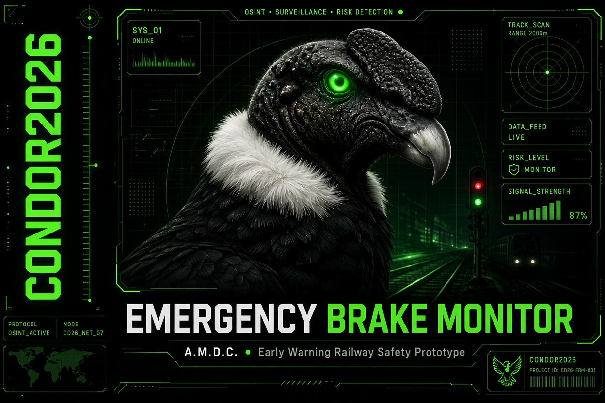
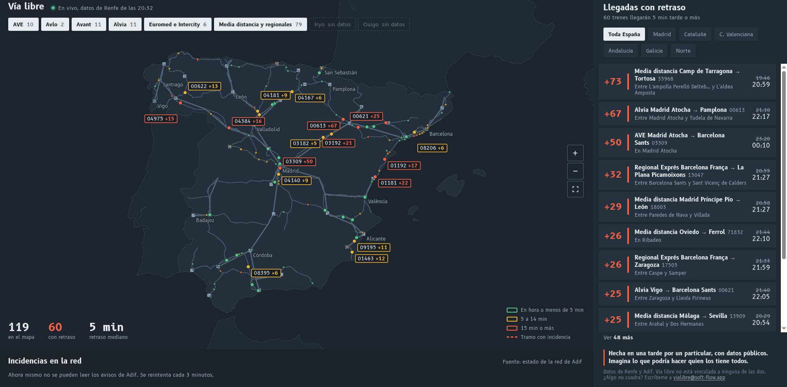
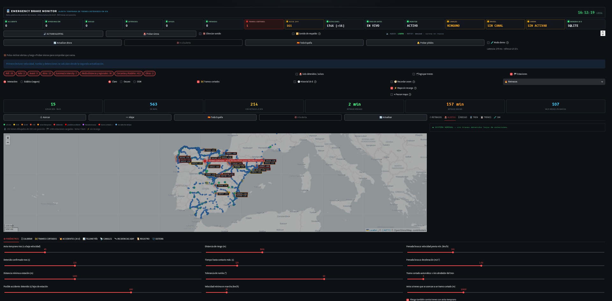
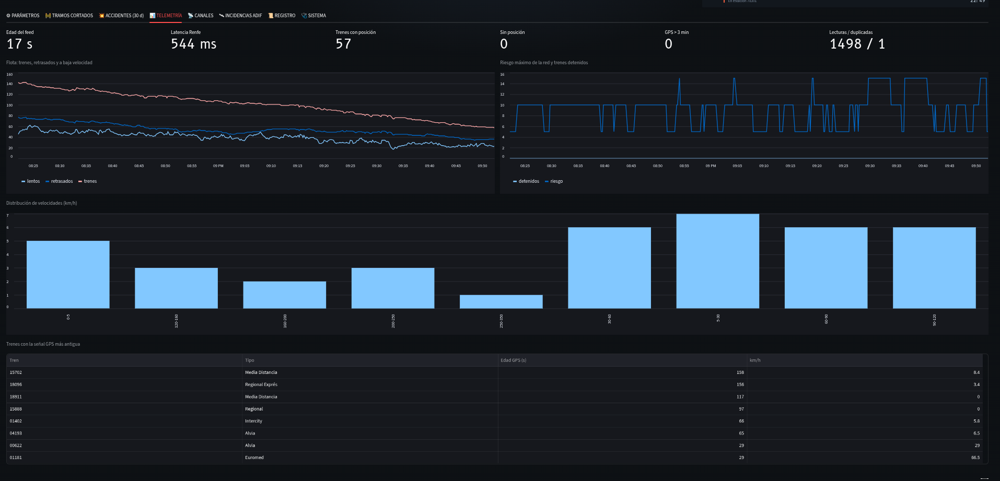

# 🚆 Emergency Brake Monitor (A.M.D.C.)


> **Prototipo experimental.** Herramienta de observación y alerta temprana para el seguimiento de trenes en tiempo real. Publicada como código abierto para que la comunidad pueda revisarla, mejorarla y utilizarla.

---

## ⚠️ Aviso importante (leer antes de nada)

- **Esto NO es un sistema de seguridad ferroviaria.** No sustituye ni complementa a ASFA, ERTMS, LZB, ni a los centros de regulación de Adif o Renfe.
- Es un **prototipo de observación y análisis** basado en datos públicos. Los avisos que genera (proximidad, detenciones, frenadas) son **heurísticos** y pueden producir **falsos positivos y falsos negativos**.
- Los datos de posición pueden tener retrasos, errores o desaparecer sin aviso (el endpoint no es oficial).
- **No tomes ninguna decisión operativa, de seguridad o de gestión ferroviaria basándote en esta herramienta.**
- Si detectas un problema real en la red, contacta con Adif o Renfe a través de sus canales oficiales.
- **El sistema de notificaciones (Telegram, ntfy, webhook) está implementado en el código, pero NO ha sido probado en un entorno real por el autor.** La lógica de envío existe, pero no se ha validado con credenciales reales ni con servidores en producción. Si decides usarlo, hazlo bajo tu propia responsabilidad y prueba primero con un mensaje de test (el código incluye un botón de "Enviar mensaje de prueba").

> **"En memoria de las víctimas y de los maquinistas que, como última opción, accionaron el freno."**

## 📖 La historia detrás del proyecto

Hace pocos días, un civil desarrolló una aplicación para avisar de los retrasos de Renfe. Le llovieron las críticas. Se le acusó de falta de innovación, de que era un "prototipo básico" y de que no aportaba nada nuevo. El chico se defendió: *"Si yo pude, ¿por qué no lo hizo Renfe?"*. Pero la presión y el acoso hicieron que este pusiera candado en su cuenta de X.

Mientras todo eso pasaba, yo estaba construyendo otra cosa. Mientras otros se limitaban a criticar al chico y a decir que su idea no era innovadora, yo, que programo, pensaba en cómo mejorarla. Tenía ideas. Y me cabreé.

Así nació **Emergency Brake Monitor**, un sistema que lleva las siglas **A.M.D.C.** grabadas en su nombre. No son siglas técnicas ni un acrónimo de laboratorio. Son las iniciales de **los dos maquinistas que, la semana pasada, perdieron la vida en el accidente ferroviario de España**. Ellos, como tantos otros antes, **accionaron la palanca del freno como última opción**. No pudieron evitar el impacto, pero lo intentaron hasta el final. Este proyecto va en su memoria, y en la de todas las víctimas. Pero, sobre todo, es una promesa: **que otros no pasen por lo mismo**. Que la próxima vez, la alarma suene antes de que la única opción sea accionar el freno a mano.



## 🛠️ ¿Qué es y para qué sirve?

**Emergency Brake Monitor** no es una app de retrasos. Es un sistema de **fusión de datos y monitorización de seguridad ferroviaria** que utiliza datos públicos de posición de trenes (Renfe/Adif) para detectar situaciones de peligro en tiempo real.

Su objetivo principal es **prevenir alcances y accidentes** cuando un tren se detiene en vía (por avería, incidente o cualquier motivo) y otro tren se aproxima por detrás. La aplicación genera una **alerta crítica sonora y visual** (similar a la alarma de un avión cuando detecta una colisión inminente) que no se detiene hasta que el operador la reconoce y toma acción.

**La app sirve para que otros no pasen por lo mismo y lleguen a frenar a tiempo cuando se para un tren delante, como en España.** Para que la alarma suene antes de que la única opción sea accionar el freno a mano.

## ⚙️ ¿Cómo funciona? (Explicación técnica y detallada)

El sistema se compone de varios módulos que trabajan en conjunto. Aquí tienes el desglose completo:

### 1. Monitor en segundo plano (hilo independiente)

- **Hilo de ejecución:** Un hilo independiente de la interfaz (daemon) sondea constantemente el feed público de Renfe (`flotaLD.json`) cada pocos segundos. Esto permite que el sistema siga funcionando aunque no haya ninguna pestaña del navegador abierta.
- **Almacenamiento de estado:** Para cada tren, guarda posición, velocidad, rumbo, retraso, matrícula, accesibilidad, origen/destino, próxima estación, etc.
- **Detección de anomalías:** Si un tren reduce su velocidad por debajo de 5 km/h y se mantiene así durante un tiempo configurable (por defecto 30-60 segundos) **lejos de una estación** (a más de 1 km), el sistema lo marca como "posible detenido en vía".

### 2. Fusión de datos multi-fuente

El sistema no se limita a un solo JSON. Cruza varias fuentes públicas para enriquecer la información y reducir falsos positivos:

- **Larga distancia:** `flotaLD.json` (posiciones, retrasos, estaciones).
- **Cercanías/Rodalies/Tram:** GTFS-RT de Renfe (`vehicle_positions.json` y `trip_updates.json`), que aporta posiciones y retrasos de la red completa.
- **Estaciones:** CSV oficial de Renfe (código, nombre, coordenadas, provincia), GTFS estático (`stops.txt` de los zip de Renfe) y OpenStreetMap vía Overpass (nodos `railway=station`).
- **Avisos oficiales:** GTFS-RT `alerts.json` (avisos de Renfe) y, opcionalmente, una URL JSON de Adif configurable.
- **Rutas y horarios:** `trenesConEstacionesLD.json` (para calcular la hora de llegada al destino).

### 3. Cálculo de riesgo de alcance (TTC)

- Si hay un tren detenido (o sospechoso de estarlo) y otro tren en movimiento se aproxima por la misma vía (mismo rumbo) y a una distancia y velocidad que implican un **tiempo hasta el contacto (TTC)** menor al umbral configurado (por defecto 120 segundos), se dispara una **alerta de riesgo crítico**.
- El sistema calcula el TTC dividiendo la distancia entre la velocidad del tren que se aproxima.
- También avisa si el tren que se aproxima está a una distancia menor que la **distancia de frenado necesaria** para igualar la velocidad del tren de delante.

### 4. Detección de aproximación peligrosa entre trenes en movimiento (NUEVO)

- **No hace falta que el tren de delante esté parado.** El sistema detecta si un tren rápido se acerca por detrás a uno más lento (mismo sentido, misma línea aproximada) y calcula la **distancia de frenado necesaria**.
- Usa un filtro de **desvío lateral máximo** (por defecto 250 m) y **tolerancia de rumbo** (por defecto 35°) para asegurar que van por la misma vía.
- Si el hueco es menor que la distancia de frenado o el TTC es bajo, avisa. Esto evita el escenario de "33 km/h" que se ve en las noticias.

### 5. Detección de frenadas bruscas

- El sistema calcula la **deceleración** de cada tren (m/s²) comparando lecturas consecutivas.
- Si un tren frena bruscamente (deceleración > 1.0 m/s²) lejos de una estación, se genera una alerta.
- Se usa una **memoria de frenada** (`brake_memory`) para mantener la alerta activa durante un tiempo (por defecto 120 s) aunque la deceleración ya haya terminado.

### 6. Tramos cortados automáticos

- Cuando se detecta un posible accidente, el sistema **cierra automáticamente un tramo** de vía (una polilínea aproximada alrededor del tren, con una semilongitud configurable, por defecto 5 km) y avisa a cualquier tren que se dirija hacia ese tramo.
- El tramo se dibuja en el mapa con una línea roja discontinua y una etiqueta "TRAMO CORTADO".
- Se puede reabrir manualmente desde la interfaz.

### 7. Memoria persistente (SQLite)

- Todos los incidentes (detenciones, frenadas, riesgos, accidentes, aproximaciones) se guardan en una base de datos local durante **30 días**.
- Esto permite analizar patrones, descargar historiales en CSV y tener un registro de lo ocurrido incluso si se cierra la aplicación.
- La base de datos se purga automáticamente cada 6 horas para eliminar registros antiguos.

### 8. Canales de aviso

- **Interfaz tipo cabina:** Anunciadores (lámparas de estado), master warning (aviso maestro), panel EICAS (mensajes por prioridad).
- **Sirena continua en el navegador:** Dos tonos distintos según la gravedad (barrido lento para "detenido", dos tonos alternos para "riesgo crítico"). Solo se detiene al pulsar "RECONOCER".
- **Sirena de respaldo nativa:** Un reproductor de audio WAV en bucle, por si el navegador bloquea el audio del puente JS.
- **Notificaciones push:** Telegram, ntfy y webhooks (configurables mediante variables de entorno o `st.secrets`). No probados en entorno real.
- **Voz:** El navegador lee el mensaje de la alerta en español (si el usuario lo permite).

### 9. Reducción de falsos positivos (la clave del sistema)

Detectar un tren parado es fácil; detectarlo **sin equivocarte** es lo difícil. El sistema usa varias capas de filtrado:

- **Estados del feed:** Si el GTFS-RT de Cercanías dice `STOPPED_AT` o `INCOMING_AT`, el tren está en estación y **no se alarma**.
- **Igualdad de estaciones:** Si `est_ant == est_sig` (el tren está "En [estación]"), no se alarma.
- **Radio de estación dinámico:** Se compara la distancia a la estación más cercana (descargada o **aprendida sobre la marcha**).
- **Aprendizaje continuo:** Si un tren se detiene y el feed dice que está en una estación, el sistema **memoriza sus coordenadas** para no volver a fallar.
- **Plausibilidad:** Si hay 3 o más accidentes simultáneos, se descartan (es un fallo de datos, no una hecatombe).
- **Límite anti-saturación:** Máximo 6 envíos cada 5 minutos para evitar spam.
- **Instancia única:** Un archivo `.pid` evita que dos copias del programa envíen avisos duplicados.
- **Filtro de GPS antiguo:** Si la señal GPS de un tren tiene más de 600 segundos, se pinta en gris y no genera alarmas.
- **Multiplicador para Cercanías:** Las posiciones de Cercanías son menos fiables, así que los tiempos se multiplican por 3 para ser más prudentes.

### 10. Herramientas de calibración y prueba

- **Perfiles de calibración:** Estricto, Normal y Sensible. Ajustan los umbrales de una vez (aviso temprano, detenido, radio de estación, accidente, frenada, aproximación).
- **Pestaña CALIBRAR:** Muestra cuántos trenes se marcarían con otros umbrales, qué trenes generan más alertas y una tabla de sensibilidad.
- **Autodiagnóstico:** Ejecuta escenarios sintéticos con tu calibración para comprobar que cada regla funciona (parado lejos, parado en estación, aproximación, plausibilidad, Cercanías, sin estaciones, etc.).
- **Simulador (SIM-001):** Un tren virtual que pasa por las mismas reglas que los reales. Puedes crear uno, acelerar, frenar bruscamente, pararlo y ver cómo responde el sistema **sin esperar a que ocurra algo real**. Sus avisos no se envían a Telegram ni se guardan en la base de datos.

### 11. Interfaz de usuario (Streamlit)

- **Mapa interactivo (Folium):** Todos los trenes con colores según estado (normal, detenido, frenada, riesgo, accidente). Modo "sin recarga" que actualiza los trenes sin recargar el mapa (conserva zoom y posición).
- **Paneles de telemetría:** Velocidad media, retrasos, series temporales, histograma de velocidades, trenes con GPS más antiguo.
- **Ficha detallada de cada tren:** Estado, riesgo, retraso, velocidad, rumbo, deceleración, ubicación, próxima parada, hora de llegada prevista y estimada, material, accesibilidad.
- **Pestañas:** Parámetros, Calibrar, Tramos cortados, Accidentes (30 días), Telemetría, Canales, Incidencias Adif, Registro, Sistema, Simulador.
- **Contraseña de acceso:** Se puede proteger la interfaz con `EBM_PASSWORD`.
- **Mapa de calor:** Retrasos, densidad o riesgo.
- **Historial de 30 días:** Puntos de incidentes en el mapa.

## 🚀 ¿En qué se diferencia de otras herramientas? ¿Por qué es único e innovador?

- **No es un simple visor de retrasos.** La mayoría de apps ferroviarias solo muestran horarios y retrasos. Esta herramienta **detecta activamente situaciones de peligro** y genera alertas en tiempo real.
- **Fusión de datos multi-fuente.** No se limita a un JSON: cruza larga distancia, Cercanías (GTFS-RT), GTFS estático, OpenStreetMap (Overpass) y el CSV oficial de Renfe. Eso es **inteligencia de datos**.
- **Aprendizaje de estaciones sobre la marcha.** Si el feed dice que un tren está en una estación, el sistema memoriza sus coordenadas para no volver a dar falsos positivos.
- **Reducción activa de falsos positivos.** Usa estados del feed (`STOPPED_AT`), igualdad de estaciones, radios dinámicos, plausibilidad y límites anti-saturación.
- **Detección de aproximación entre trenes en movimiento.** No solo avisa si el de delante está parado: también si va lento y el de detrás no frena a tiempo.
- **Alerta sonora continua e insistente.** Como en una cabina de avión, no se silencia sola; requiere reconocimiento humano.
- **Simulador integrado.** Puedes probar la herramienta sin esperar a que ocurra un incidente real.
- **Autodiagnóstico.** Verifica que cada regla funciona con tu calibración actual.
- **Instancia única.** Evita que dos copias del programa envíen avisos duplicados.
- **Código abierto y modular.** Cualquiera puede revisarlo, mejorarlo o adaptarlo.

**En resumen: no existe nada así en el mercado público.** Ni Renfe ni Adif ofrecen una herramienta de este tipo a los ciudadanos. Y aunque existen sistemas internos de seguridad (ASFA, ERTMS), no están al alcance del público ni son de código abierto. **Esta es una prueba de concepto de lo que la tecnología abierta y la fusión de datos pueden hacer por la seguridad ferroviaria.**


## ⚠️ Aviso Importante: Es un Prototipo (No sustituye nada)

**Este es un prototipo funcional. No está terminado.**

- **NO sustituye** a los sistemas de seguridad ferroviaria oficiales (ASFA, ERTMS, etc.).
- **NO sustituye** a los maquinistas ni a los sistemas de señalización de Renfe o Adif.
- **NO es una herramienta de producción.** Es una prueba de concepto que usa datos públicos y heurísticas.
- Los datos de posición pueden tener retraso o errores. Los tramos automáticos son aproximados.
- La seguridad ferroviaria real requiere hardware certificado, protocolos estrictos y validación humana. Esto es solo una herramienta de apoyo y concienciación.

## 🤝 ¿Por qué la comunidad debería trabajar en esto? (Código abierto para el bien común)

**La publico precisamente para eso: para que otros puedan hacer algo con ella, agregar mejoras y llevarla más lejos.** Porque la seguridad no debería depender de que una sola persona tenga todas las respuestas. Este es el punto de partida. El siguiente paso lo damos entre todos.

Creo firmemente que la seguridad ferroviaria es un **bien común**. No debería ser un secreto industrial ni un privilegio de unos pocos. Si esta herramienta puede salvar una vida, aunque sea en una fracción de prueba, ya habrá valido la pena. Pero para que sea realmente útil, necesita crecer, ser revisada, criticada y mejorada por la comunidad.

**Quien quiera, que participe. Que lo agarre, lo mejore y lo adapte.** No busco protagonismo; busco que la idea viva y evolucione.

### Ideas para futuras mejoras (¡anímate a contribuir!):

1. **Integración de GPS y Bluetooth:** Para que el sistema nunca se quede sin señal. Si un tren pierde la cobertura GPS, el sistema podría usar balizas Bluetooth o sensores de proximidad para seguir detectando la posición y el estado de los trenes. (Yo mismo intentaré hacerlo, pero no sé si llegaré; por eso lo dejo aquí).
2. **Datos de Adif en tiempo real:** Integrar una API oficial de incidencias (si se abre al público) para cruzar datos y mejorar la precisión de los tramos cortados.
3. **Modelos predictivos:** Usar machine learning para predecir paradas no programadas antes de que ocurran, analizando patrones históricos.
4. **Interfaz móvil:** Una app ligera para que los maquinistas o supervisores reciban las alertas en el móvil.
5. **Validación con datos históricos:** Probar el sistema con datos de accidentes pasados para calibrar los umbrales y mejorar la detección.
6. **Integración con hardware:** Conectar el sistema a sensores físicos (acelerómetros, GPS diferencial) para mayor precisión.

## 🛠️ Instalación y Uso

### Requisitos
- Python 3.9 o superior.
- Conexión a Internet (para obtener datos de Renfe).
- Navegador web moderno (Chrome, Firefox, Edge).

### Instalación
```bash
pip install streamlit streamlit-folium streamlit-autorefresh folium pandas numpy requests
```

### Ejecución
```bash
streamlit run renfealarm.py
```

### Configuración (opcional)
Puedes configurar canales de aviso mediante variables de entorno o `st.secrets`:
- `TELEGRAM_BOT_TOKEN`, `TELEGRAM_CHAT_ID`
- `NTFY_TOPIC`, `NTFY_SERVER`
- `ALERT_WEBHOOK_URL`
- `ADIF_INCIDENTS_URL` (JSON con avisos de Adif)
- `EBM_DB` (ruta de la base de datos SQLite)
- `CARTO_API_KEY` (para mapas base)
- `EBM_PASSWORD` (para proteger la interfaz con contraseña)
- `EBM_EXTRA_GTFSRT` (URLs extra de GTFS-RT separadas por comas)

## 🙏 Créditos y Méritos

- **Datos públicos:** A Renfe y Adif por proporcionar los datos de posición de trenes, estaciones y avisos a través de sus visores públicos. A OpenStreetMap (Overpass) por las estaciones. Sin ellos, esto no sería posible.
- **Tecnología:** Streamlit, Folium, Pandas, Numpy, SQLite.
- **Inspiración:** Al chico que se cansó de las críticas. Y a todos los maquinistas que, como última opción, accionaron el freno.
- **Comunidad:** A todos los que creen que la tecnología debe estar al servicio de la seguridad y el bien común.

## 📄 Licencia
- CC BY-NC-SA.

> **"Que la alarma suene antes de que la única opción sea accionar el freno a mano."**
> 
> *— En memoria de las víctimas y de los maquinistas que, como última opción, accionaron la palanca del freno.*

